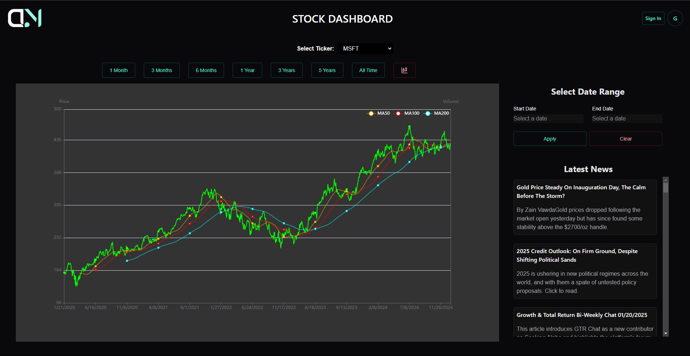
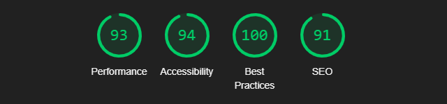

# Dhanmantri



[](https://dhanmantri-app.vercel.app/)
[](https://dhanmantri-backend.onrender.com/health)
[](https://github.com/Punosie/DhanMantri/actions/workflows/ci.yml)

## Overview

DhanMantri is a NIFTY 50 stock dashboard. It charts daily OHLCV data as a line or candlestick chart with 50/100/200-day moving averages, lets you pick a time range or a custom date range, and shows the latest market news.

- **Frontend:** React 19 + Vite 8 + Chakra UI 3 + Apache ECharts 6, deployed on Vercel
- **Backend:** Node 22 + Express 5 + the MongoDB driver, deployed on Render
- **DataFetcher:** Python 3.14 + yfinance, upserts daily candles into MongoDB (scheduled with GitHub Actions)
- **Auth:** Firebase Google sign-in (optional) · **News:** Finnhub (optional)

```
Yahoo Finance ──► DataFetcher (Python 3.14) ──► MongoDB Atlas ◄── Backend API (Express) ◄── Frontend (Vercel)
                    daily GitHub Action              STOCKS            /api/stocks/fetch          Finnhub news
```

## Project structure

| Folder | What it is |
| --- | --- |
| [`Frontend/`](Frontend) | Vite SPA, Playwright end-to-end tests in `Frontend/e2e` |
| [`Backend/`](Backend) | Stock data API (`GET /api/stocks/fetch`, `GET /health`) |
| [`DataFetcher/`](DataFetcher) | Script that backfills and incrementally updates candles |
| `render.yaml` | Render Blueprint for the backend |
| `.github/workflows` | CI (lint, build, Playwright) and the daily data fetch |

## Local setup

Prerequisites: Node.js 22.12+, Python 3.14 (with [uv](https://docs.astral.sh/uv/) or pip), and MongoDB (Atlas, or local via `docker run -d -p 27017:27017 --name dhanmantri-mongo mongo:8`; on Linux kernel 6.19+ use `mongo:7.0`, since MongoDB 8 refuses to start there, see [SERVER-121912](https://jira.mongodb.org/browse/SERVER-121912)).

```bash
# 1. Load stock data
cd DataFetcher
cp .env.example .env            # set MONGO_URL
uv venv --python 3.14 && uv pip install -r requirements.txt   # or: python -m venv .venv && pip install -r requirements.txt
cd src && ../.venv/Scripts/python main.py                      # macOS/Linux: ../.venv/bin/python main.py

# 2. Start the API on http://localhost:5000
cd ../../Backend
cp .env.example .env            # set MONGO_URL
npm install
npm run dev

# 3. Start the frontend on http://localhost:5173
cd ../Frontend
cp .env.example .env            # optional: Firebase and Finnhub keys
npm install
npm run dev
```

The first DataFetcher run backfills from `FETCH_START` (default 2015-01-01); later runs fetch only new candles and upsert on `(Symbol, Date)`, so reruns never duplicate rows.

## Environment variables

**Backend** (`Backend/.env`)

| Variable | Default | Purpose |
| --- | --- | --- |
| `MONGO_URL` | required | MongoDB connection string |
| `MONGO_DB` / `MONGO_COLLECTION` | `stockdata` / `STOCKS` | Database and collection |
| `PORT` | `5000` | HTTP port |
| `CORS_ORIGINS` | deployed frontends + localhost | Comma-separated allowed origins |
| `CORS_ORIGIN_REGEX` | dhanmantri Vercel previews | Extra allowed origins as a regex |
| `RATE_LIMIT_PER_MINUTE` | `300` | Stock API requests per minute per IP |
| `LOG_LEVEL` | `info` | `debug` also logs health checks and pings |
| `LOG_PRETTY` | `true` in a terminal | Human-readable logs instead of JSON |
| `LOG_DB_COMMANDS` | `true` | Log every outgoing MongoDB command with latency |
| `CACHE_MAX_AGE` | `300` | Seconds browsers/CDNs may cache stock responses |

**Frontend** (`Frontend/.env`, all optional)

| Variable | Purpose |
| --- | --- |
| `VITE_API_URL` | Backend URL (dev default `http://localhost:5000`, prod default the Render API) |
| `VITE_LOG_REQUESTS` | `false` silences request/response logging in the browser console |
| `VITE_FINNHUB_API_KEY` | Enables the news panel |
| `VITE_FIREBASE_API_KEY`, `VITE_AUTH_DOMAIN`, `VITE_PROJECT_ID`, `VITE_STORAGE_BUCKET`, `VITE_MESSAGING_SENDER_ID`, `VITE_APP_ID`, `VITE_MEASUREMENT_ID` | Enables Google sign-in |

**DataFetcher** (`DataFetcher/.env`): `MONGO_URL`, `MONGO_DB`, `MONGO_COLLECTION`, `FETCH_START`, `LOG_LEVEL` (`DEBUG` logs every Yahoo Finance HTTP request and MongoDB command).

## Request logging

Every hop is logged with its latency, and a request ID ties the logs together:

- **Backend, incoming:** one line per request (method, URL, status, duration, origin, cache header), via pino-http. The `X-Request-Id` response header carries the ID (an incoming `X-Request-Id` is reused).
- **Backend, outgoing:** every MongoDB command (`find`, `getMore`, …) with its duration and the `reqId` of the request that caused it.
- **Frontend:** the browser console shows each outgoing call (`[http:api] → #1 GET …`) and its response or failure (`← #1 200 … 16ms`) with the backend's `requestId`, for both the API and Finnhub (API keys are redacted).
- **DataFetcher:** per-symbol fetch timings; with `LOG_LEVEL=DEBUG`, every Yahoo Finance request and MongoDB command.

On Render the backend writes JSON lines, so logs can be searched by `reqId` in the dashboard.

## Tests

```bash
cd Frontend
npx playwright install chromium
npm run test:e2e        # builds the app, starts the API, runs API, UI, SEO and performance tests
```

The suite needs MongoDB with data (step 1 above). It covers API validation and caching, stock switching, time and date ranges, the candlestick tooltip, persisted settings, SEO tags and assets, a page-load budget (FCP < 1.5 s, LCP < 2.5 s, chart visible < 4 s), and a mobile layout check. Set `E2E_BASE_URL` and `E2E_API_URL` to run it against a deployed environment.

## Deployment

**Backend → Render** (`dhanmantri-backend`)
1. Use the existing service, or create one from `render.yaml` (Dashboard → Blueprints).
2. Set `MONGO_URL` in the service's Environment tab. The other variables come from `render.yaml`.
3. Pushes to `main` deploy automatically. `/health` returns 503 when MongoDB is unreachable.

**Frontend → Vercel** (project `dhanmantri`, root directory `Frontend`, production domain `dhanmantri-app.vercel.app`)
1. `vercel link` inside `Frontend/`, or import the repo with *Root Directory* `Frontend`.
2. Add any `VITE_*` variables you need (Firebase, Finnhub, and `VITE_API_URL` if the API URL changes).
3. Pushes to `main` deploy production and PRs get preview deployments (Git integration). For a manual deploy, run `vercel --prod` from the repository root.
4. For Google sign-in, add the Vercel domain to Firebase Auth → Settings → Authorized domains.

**Data → GitHub Actions**: add the `MONGO_URL` repository secret. `Fetch stock data` then runs on weekdays at 22:30 UTC, or on demand from the Actions tab.

## SEO and performance

- Full meta tags, Open Graph/Twitter cards, JSON-LD, canonical URL, `robots.txt`, `sitemap.xml`, a web manifest and a favicon set. The page title includes the selected stock.
- Firebase and ECharts load lazily: the initial JS is about 190 KB gzipped, down from 650 KB, and ECharts downloads in parallel with the first data request.
- Chakra ships only the component styles that are used; only the needed ECharts modules are imported; line series skip per-point symbols and use LTTB sampling.
- API responses are projected to chart fields, served from a `(Symbol, Date)` index, gzip-compressed and cacheable (`Cache-Control` + ETag). Hashed assets are cached immutably on Vercel.

## Developer tooling

The repository is set up for [graphify](https://github.com/safishamsi/graphify) (see `CLAUDE.md`). The graph in `graphify-out/` is generated locally and not committed: run `graphify update .` to build it and `graphify hook install` to rebuild it after every commit.

## Analytics

### Lighthouse Performance Report



## License

This project is licensed under the WTF License - see the [LICENSE](License.md) file for details.
